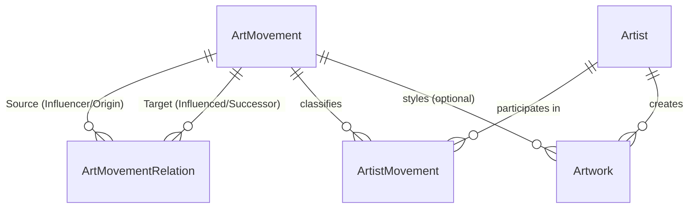

# Art History Map

> Sanat akımlarının tarihsel etkileşim, tepki ve evrilme dinamiklerini yönlü çizge (directed graph) ontolojisiyle modelleyen etkileşimli zaman çizelgesi ve ilişki haritası platformu.

[](https://dotnet.microsoft.com/)
[](https://docs.microsoft.com/ef/core/)
[](https://www.postgresql.org/)
[](#mimari-ve-tasarım-prensipleri)

---

## Proje Vizyonu ve Çözülen Problem

Geleneksel sanat tarihi platformları ve veritabanları, sanat akımlarını çoğunlukla tekil bir kronolojik listede veya katı bir hiyerarşik ağaç (`Parent-Child`) yapısında sunar. Ancak tarihsel gerçeklik bir ağaç değil, **yönlü ve çok boyutlu bir çizgedir (Directed Graph)**:

* Bir akım birden fazla öncül akımdan beslenebilir (*Örn: Empresyonizm hem Realizm'den hem Romantizm'den etkilenmiştir*).
* Bir ardıl akım, öncülünden teknik olarak evrilirken (*EvolvedInto*), aynı zamanda onun felsefesine başkaldırabilir (*ReactedAgainst*).
* Sanatçılar kariyerleri boyunca birden fazla akımın kurucusu, öncüsü veya takipçisi olabilir.

**Art History Map**, bu karmaşık ontolojiyi ilişkisel bir veritabanında yüksek veri bütünlüğüyle modelleyerek; ileride geliştirilecek görsel harita (Cytoscape/D3) ve zaman çizelgesi servislerine optimize edilmiş bir veri altyapısı sağlar.

---

## Mimari ve Tasarım Prensipleri

Proje, Domain-Driven Design (DDD) ve Clean Architecture ilkeleri gözetilerek, hiçbir harici çatıya (ABP vb.) bağımlı olmadan sıfırdan inşa edilmiştir.

### 1. Yönlü Çizge (Directed Graph Edge) Modellemesi
Sanat akımları arasındaki ilişkiler tek bir tabloda `ParentId` ile değil, bağımsız bir **kenar (edge) varlığı** olan `ArtMovementRelation` ile temsil edilir:
* **Semantik Yön:** `SourceMovementId` (eylemi başlatan/öncül) $\rightarrow$ `TargetMovementId` (etkilenen/tepki duyan hedef).
* **Çoklu Semantik Bağ:** Aynı iki akım arasında birden fazla ilişki türü bulunabilir. Bu kural, `(SourceMovementId, TargetMovementId, RelationType)` üzerinde tanımlı **Composite Unique Index** ile garanti altına alınmıştır.
* **Self-Loop İzolasyonu:** Bir akımın kendini etkilemesini engellemek için PostgreSQL seviyesinde `CHECK ("SourceMovementId" <> "TargetMovementId")` kısıtı uygulanmıştır.

### 2. Defansif Cascade ve Veri Bütünlüğü Stratejisi
* **`Artist` $\rightarrow$ `Artwork` (`DeleteBehavior.Restrict`):** Bir sanatçı silindiğinde ona bağlı yüzlerce eserin sessizce silinmesini engeller (`accidental data loss`).
* **`ArtMovement` $\rightarrow$ `Artwork` (`DeleteBehavior.SetNull`):** Akım silinse dahi eser ve sanatçı bağı korunur.
* **`ArtMovement` $\rightarrow$ `ArtMovementRelation` (`DeleteBehavior.Cascade`):** Düğüm silindiğinde graf bütünlüğü için kenarlar otomatik temizlenir.

### 3. Sıfır Sır (Zero-Secret) ve Tip Güvenliği
* **Secret Isolation:** Kod tabanında, repoda veya konfigürasyon dosyalarında hiçbir parola yer almaz. Tasarım zamanında bağlantı dizesi tamamen `.NET Secret Manager` (`dotnet user-secrets`) üzerinden yönetilir.
* **Type-Safe Persistence:** Domain seviyesindeki enum değerleri (`MovementRelationType`, `ArtistMovementRole`), veritabanında `varchar` olarak saklanarak hem C# derleme güvenliği hem de ham SQL okunabilirliği sağlanmıştır.

---

## Veri Modeli



* **`ArtMovement`:** Akımın adı, tarihsel dönemi, köken bölgesi ve ilişkileri.
* **`ArtMovementRelation`:** Akımlar arası yönlü etkileşim, başkaldırı ve evrilme kenarları.
* **`Artist`:** Sanatçı biyografisi, milliyeti ve yaşam aralıkları.
* **`ArtistMovement`:** Sanatçının akım içerisindeki rolü (`Founder`, `KeyFigure`, `Pioneer`), aktif yılları ve birincil aidiyeti (`IsPrimary`).
* **`Artwork`:** Eserin başlığı, yapım yılı, tekniği, sergilendiği müze ve sanatçı bağı.

---

## Hızlı Başlangıç

### 1. PostgreSQL Konteynerini Başlatın
```bash
docker run -d \
  --name arthistory-postgres \
  -e POSTGRES_DB=arthistory \
  -e POSTGRES_USER=postgres \
  -e POSTGRES_PASSWORD=<SIFRENIZ> \
  -p 127.0.0.1:5432:5432 \
  --restart unless-stopped \
  postgres:16-alpine
```

### 2. Bağlantı Dizesini User-Secrets'a Ekleyin
```bash
dotnet user-secrets set "ConnectionStrings:DefaultConnection" \
  "Host=localhost;Port=5432;Database=arthistory;Username=postgres;Password=<SIFRENIZ>" \
  --project src/ArtHistoryMap.Infrastructure
```

### 3. Veritabanını Güncelleyin (Migration & Seed Data)
11 sanat akımı (Rönesans'tan Sürrealizm'e), 12 yönlü etkileşim bağı, 10 sanatçı ve 10 ikonik eser şemayla birlikte otomatik basılır:
```bash
dotnet ef database update \
  --project src/ArtHistoryMap.Infrastructure \
  --startup-project src/ArtHistoryMap.Infrastructure
```

### 4. Doğrulama
```bash
docker exec -it arthistory-postgres psql -U postgres -d arthistory -c "
SELECT sm.\"Name\" AS \"Kaynak Akım\", r.\"RelationType\" AS \"İlişki\", tm.\"Name\" AS \"Hedef Akım\"
FROM art_movement_relations r
JOIN art_movements sm ON r.\"SourceMovementId\" = sm.\"Id\"
JOIN art_movements tm ON r.\"TargetMovementId\" = tm.\"Id\"
LIMIT 5;
"
```

---

## Proje Durumu ve Yol Haritası

- [x] **Faz 1: Veritabanı ve Domain Ontolojisi**
  - [x] Yönlü graf kenar mimarisi ve Fluent API kısıtları
  - [x] Seed data (11 akım, 12 yönlü ilişki, sanatçılar, eserler)
  - [x] User-secrets entegrasyonu ve güvenlik denetimi
- [ ] **Faz 2: Application & Web API Katmanı**
  - [ ] Cytoscape/D3 uyumlu `GET /api/movements/graph` (`nodes` & `edges`) uç noktası
  - [ ] Kronolojik zaman çizelgesi sorguları ve filtreleme servisleri
  - [ ] Global exception middleware & FluentValidation
- [ ] **Faz 3: Etkileşimli Kullanıcı Arayüzü**
  - [ ] React tabanlı zaman çizelgesi kaydırıcısı (Timeline Slider)
  - [ ] Etkileşimli yönlü çizge ağ haritası
